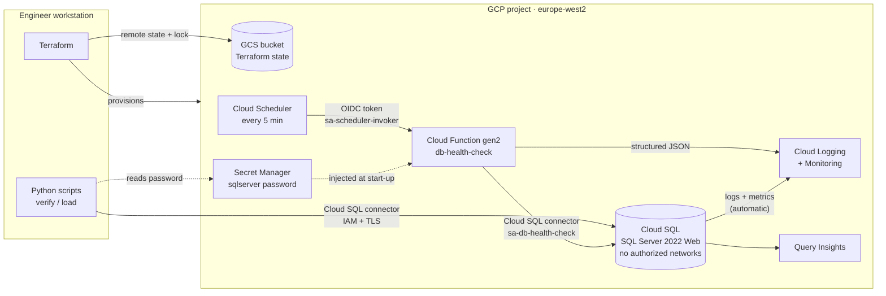

# GCP Database SRE Toolkit

A practical toolkit demonstrating Site Reliability Engineering practices applied to database operations on Google Cloud. Built to showcase modern SRE skills — Infrastructure as Code, observability, automation, and AI-augmented engineering — combined with deep database operational experience.

## Why This Project

This is the GCP counterpart to [`azure-db-sre-toolkit`](https://github.com/craiga251/azure-db-sre-toolkit), which covered the same ground on Azure. The move to GCP followed the Azure free trial expiring while a 60-day GCP credit was still available — rather than let that runway go unused, this repo applies the same IaC discipline (remote state, plan/apply review, DRY, tagging/labeling) to Google Cloud's platform and IAM model.

Terraform fundamentals (providers, state, plan vs apply) are not re-explained here — see the Azure repo's `docs/terraform-notes.md` Day 1 entry for that groundwork. This repo's notes focus on what's actually different on GCP: resource hierarchy, IAM, and service-specific configuration.

## Architecture



There is no direct network path to the database: the instance has a public IP but no authorized networks, so every connection goes through the Cloud SQL connector, which authenticates the caller with IAM before the SQL login happens.

## Tech Stack

- **Cloud:** Google Cloud Platform (free trial credit)
- **Infrastructure as Code:** Terraform
- **CI/CD:** GitHub Actions
- **Compute:** Cloud Functions (gen2) triggered by Cloud Scheduler
- **Database:** Cloud SQL for SQL Server 2022 (Web edition)
- **Observability:** Cloud Monitoring, Cloud Logging, Grafana Cloud
- **Scripting:** PowerShell, Python
- **AI tooling:** GitHub Copilot, LLM APIs for log analysis

## Project Status

| Phase | Status | Description |
|-------|--------|-------------|
| 0 | ✅ Complete | Foundations and tooling setup (gcloud CLI, project, remote state, Terraform provider) |
| 1 | ✅ Complete | Terraform infrastructure provisioning (Cloud SQL, Secret Manager, scheduled health-check function) |
| 2 | ⬜ Not started | Git workflow and CI/CD |
| 3 | ⬜ Not started | SRE automation scripts |
| 4 | ⬜ Not started | Observability and SLIs |
| 5 | ⬜ Not started | AI-augmented operations |
| 6 | ⬜ Not started | Documentation and publishing |

## Repository Structure

```
gcp-db-sre-toolkit/
├── terraform/              # Infrastructure as Code (Phase 1)
│   ├── main.tf             # Providers, APIs, Cloud SQL, Secret Manager
│   ├── health_check.tf     # Scheduled health-check function, service accounts, IAM
│   ├── variables.tf
│   ├── outputs.tf
│   └── terraform.tfvars.example
├── functions/
│   └── db_health_check/    # Cloud Function source (Python)
├── scripts/
│   ├── powershell/         # PowerShell automation scripts (Phase 3)
│   └── python/             # Connection smoke test, workload generator
├── .github/
│   └── workflows/          # GitHub Actions CI/CD pipelines (Phase 2)
├── docs/
│   └── terraform-notes.md  # Design decisions and reflections
├── README.md
└── .gitignore
```

## Prerequisites

- Google Cloud account with billing/trial credit active
- `gcloud` CLI installed and authenticated (`gcloud auth login`)
- A GCP project created for this toolkit (`gcloud projects create ...`)
- Terraform CLI (>= 1.5)
- Git and GitHub account
- VS Code with Terraform and PowerShell extensions
- Python 3.10+
- PowerShell 7+

## Getting Started

> _Full setup instructions will be expanded once Phase 0/1 (project setup and infrastructure provisioning) are complete._

**Current state:** Phase 1 complete. The full stack (Cloud SQL for SQL Server Web edition, Secret Manager, and a scheduled health-check Cloud Function) applies from scratch, verifies, and destroys cleanly. Health-check results are in Cloud Logging under `jsonPayload.component="db-health-check"`. To check a running instance, install `scripts/python/requirements.txt`, then run `python scripts/python/verify_connection.py` (arguments are in the script header and come from `terraform output`).

Planned bootstrap sequence (mirroring the Azure repo's Day 3 pattern):

1. Clone this repository
2. Authenticate: `gcloud auth login` and `gcloud auth application-default login` (a dedicated `gcloud config configurations create` profile is recommended if you use other GCP accounts)
3. Create or select a GCP project and note its project ID
4. Bootstrap a GCS bucket for Terraform remote state (out-of-band, before first `terraform init`)
5. In the `terraform/` folder, copy `terraform.tfvars.example` to `terraform.tfvars` and set `project_id` and `owner`
6. Run `terraform init`, `terraform plan`, then `terraform apply`

## Infrastructure Provisioned

| Resource | Name | How it's managed | Notes |
|----------|------|------------------|-------|
| GCP project | `gcp-db-sre-toolkit-514321` | Console (one-off) | Under org `craigandersonbus1-org`, region `europe-west2` |
| GCS bucket (Terraform state) | `gcp-db-sre-toolkit-514321-tfstate` | `gcloud` bootstrap (out-of-band) | Versioned, uniform access, public access prevention; persists between sessions |
| Billing budget | `gcp-db-sre-toolkit guardrail` | `gcloud` (out-of-band) | £25/month, alerts at 50/90/100% + forecast; persists between sessions |

**Terraform-managed** (applied, verified, and destroyed each session to control cost):

| Resource | Name | Notes |
|----------|------|-------|
| Cloud SQL for SQL Server | `sql-sre-toolkit-euw2-<random hex>` | SQL Server 2022 Web, `db-custom-1-3840`, zonal, 10 GB SSD (autoresize ≤20 GB), backups, Query Insights. Public IP with no authorized networks: connector/Auth Proxy only. |
| Database | `sredb` | Application database |
| Secret Manager secret | `sql-sre-toolkit-euw2-sqlserver-password` | Generated admin password |
| Cloud Function (gen2) | `db-health-check` | Python 3.12, 512 MB, scale 0–1; structured JSON results to Cloud Logging |
| Cloud Scheduler job | `db-health-check-every-5m` | Calls the function with an OIDC token |
| Service accounts | `sa-db-health-check`, `sa-function-build`, `sa-scheduler-invoker` | Runtime / build / invoker, each with only the roles it needs |
| GCS bucket | `<project>-function-source` | Zipped function source |
| Artifact Registry | `cloud-functions` | Built function images (keep latest 3) |
| Project services | sqladmin, secretmanager, cloudtrace, cloudfunctions, cloudbuild, run, artifactregistry, cloudscheduler | `disable_on_destroy = false` |

## Design Decisions

Key architectural and tooling decisions are documented as they are made in [`docs/terraform-notes.md`](docs/terraform-notes.md), including where GCP's approach diverges from the Azure repo's.

## What I Learned

Reflections captured per phase in [`docs/terraform-notes.md`](docs/terraform-notes.md), focused on what's genuinely new versus what carried over from the Azure project.

## License

MIT
